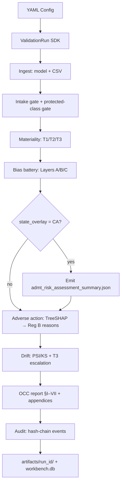

# AI Model Risk & Governance Workbench — Teaching Guide

**Audience:** You, teaching or presenting to someone with no prior context  
**Canonical demo:** P3 California overlay (`configs/german_credit_ca_overlay.yaml`)  
**Companion docs:** [Technical Deep Dive](./02-technical-deep-dive.md) · [Private Demo Script](./03-demo-script.md) (local only, not in repo)  
**Live run reference:** `german-credit-demo-ca-overlay` executed 2026-07-23 on this machine

---

## How to use this guide

Read top to bottom once. Then use the **Glossary**, **Mnemonics**, and **FAQ** as review cards before presenting. When a concept needs implementation or interview depth, follow the **Technical deep dive →** links to [02-technical-deep-dive.md](./02-technical-deep-dive.md).

**What you will be able to do after this lesson:**

1. Explain *why* this project exists and *who* it serves (validators, not lenders).
2. Walk through the full validation pipeline from YAML config to OCC report and audit chain.
3. Interpret every major artifact and statistic from a live P3 CA run.
4. Articulate design decisions, tradeoffs, and what **not** to claim.
5. Teach the material to a contextless colleague with confidence.

---

## Table of contents

1. [The problem in plain language](#1-the-problem-in-plain-language)
2. [What this project is — and is not](#2-what-this-project-is--and-is-not)
3. [Architecture at a glance](#3-architecture-at-a-glance)
4. [The canonical demo: P3 CA overlay](#4-the-canonical-demo-p3-ca-overlay)
5. [Every output artifact explained](#5-every-output-artifact-explained)
6. [Design decisions and tradeoffs](#6-design-decisions-and-tradeoffs)
7. [Build phases P0–P3 (how the project grew)](#7-build-phases-p0p3-how-the-project-grew)
8. [Appendix: P4 BISG architecture (brief)](#8-appendix-p4-bisg-architecture-brief)
9. [Glossary](#9-glossary)
10. [Mnemonics and mental models](#10-mnemonics-and-mental-models)
11. [FAQ and messaging hygiene](#11-faq-and-messaging-hygiene)
12. [Technical deep dive index](#12-technical-deep-dive-index)

---

## 1. The problem in plain language

Banks and lenders use statistical models to decide who gets credit. Regulators and internal risk teams must **validate** those models: prove they are sound, monitored, documented, and not producing unfair outcomes through proxies.

Three pressures make this hard in 2026:

| Pressure | What it means |
| -------- | ------------- |
| **Model risk guidance** | OCC Bulletin 2026-13 expects a structured, seven-section independent validation report — not a loose PowerPoint. |
| **Fair lending / ECOA** | Federal framing has shifted toward **proxy discrimination** testing (post–July 2026 Reg B emphasis) — not just “did approval rates differ?” but “could the model discriminate through stand-in variables?” |
| **Explainability gap** | SHAP attributions are not Reg B adverse-action reasons. Translating model math into **specific, consumer-facing factor descriptions** (Reg B §1002.9) is an unsolved compliance workflow — vendors often stop at charts. |

**The gap this workbench fills:** There is no open, reproducible pipeline that ties together tiering → bias/proxy battery → adverse-action methodology → drift escalation → hash-chained audit log → OCC seven-section report. Enterprise tools (ValidMind, SAS) cover MRM lifecycle but are closed and expensive. OSS libraries (Fairlearn, SHAP) provide metrics but not regulatory structure or evidence chains.

**Who is the user?** A **model validator, risk officer, compliance reviewer, or auditor** — someone who needs *evidence for review*, not someone who approves loans.

> **Technical deep dive →** [Problem and regulatory context](./02-technical-deep-dive.md#problem-and-regulatory-context)

---

## 2. What this project is — and is not

### What it is

An **open, model-agnostic validation workbench** for traditional ML credit models. You point it at:

- A frozen trained model (`german-credit-xgb-v1.2.joblib`)
- A labeled CSV (`german_credit_validation.csv`)
- A YAML config describing regulatory frame, materiality, and which modules to run

It produces:

- An **OCC 2026-13 seven-section validation report** (Markdown)
- Structured **appendices** (JSON) for bias, adverse action, drift, and audit verification
- A **hash-chained SQLite audit log** (`workbench.db`) linking every event to artifact SHA-256 hashes

**Design philosophy: compose, don't rebuild.** Fairlearn, Aequitas, SHAP, and scipy PSI do the statistics. This project differentiates on **structure, regulatory specificity, and evidence chain**.

### What it is not

| Not this | Why it matters |
| -------- | -------------- |
| Lending / decisioning system | It never approves or denies credit in production |
| Legal compliance determination | Every report embeds a disclaimer: review support only |
| Enterprise GRC platform | No multi-tenant SaaS, policy engine, or workflow UI |
| Gen-AI MRM product | Scope is traditional statistical credit models |
| US population representative demo | German Credit is 1990s German domestic data |

> **Technical deep dive →** [Scope and differentiation](./02-technical-deep-dive.md#scope-and-differentiation)

---

## 3. Architecture at a glance

### The pipeline (one sentence)

**Config → ingest gates → materiality tier → bias battery → (optional overlay) → adverse action → drift monitor → OCC report → audit chain verify.**

### Data flow diagram



### Entry points

| Surface | Command / API | Role |
| ------- | ------------- | ---- |
| **CLI** | `workbench validate run --config ...` | Canonical, CI-reproducible |
| **Python SDK** | `ValidationRun.from_config(path).run()` | Programmatic orchestration |
| **FastAPI** | `POST /validate`, `GET /audit/verify` | Thin HTTP wrapper (P2+) |
| **Notebooks** | `notebooks/01_*.ipynb` | Companion demos, not source of truth |

### The three-layer bias battery (core intellectual model)

Think of fairness testing as three questions asked in order:

| Layer | Question | Live P3 metrics (sex, ref=male) |
| ----- | -------- | ------------------------------- |
| **A — Outcomes** | Do approval rates and score distributions differ by group? | AIR ≈ **0.991**, gap ≈ **−0.007**, SMD ≈ **−0.012** |
| **B — Error parity** | Do false positives/negatives burden one group more? | FPR parity ≈ **0.987**, FNR parity ≈ **0.860** |
| **C — Proxy risk** | Can model features predict the protected attribute? | Top proxy: `num_dependents` (r≈0.15); aux classifier AUC ≈ **0.660** |

Layer A is always labeled **outcomes analysis / risk-assessment evidence** — never “ECOA disparate-impact compliance.”

> **Technical deep dive →** [Architecture overview](./02-technical-deep-dive.md#architecture-overview) · [Bias battery statistics](./02-technical-deep-dive.md#bias-battery-statistics)

---

## 4. The canonical demo: P3 CA overlay

### Why P3 CA as the spine

The P3 California overlay run exercises **every implemented module** and adds a **jurisdictional framing layer** — the strongest portfolio story. It shows the same statistical battery under federal ECOA *and* California CCPA/CPRA ADMT framing, with a dedicated overlay artifact.

### Prerequisites (one-time)

```bash
git lfs install
cd ai-mrg-bench
git lfs pull
uv sync --all-extras --dev
uv run workbench version   # → 0.0.0
```

### Run the demo

```bash
uv run workbench validate run \
  --config configs/german_credit_ca_overlay.yaml \
  --output-dir artifacts/run_ca_overlay/
```

**Expected stdout:**

```
run_id=german-credit-demo-ca-overlay
artifact_dir=.../artifacts/run_ca_overlay
report_path=.../artifacts/run_ca_overlay/validation_report.md
status=PASS
```

### Verify the audit chain

```bash
uv run workbench audit verify-chain
```

**Live result (2026-07-23):** `status=PASS`, `events=284`, `breaks=0`

### What happens inside (narrative walkthrough)

**Step 1 — Ingest and gates**

- Loads frozen XGBoost pipeline from Git LFS.
- Confirms `sex` is **not** in `feature_names_in_` (protected-class gate).
- Intake gate **PASS**: statistical credit model, not excluded category.

**Step 2 — Materiality**

- Exposure = 0.15 (15% of portfolio), purpose = `credit_decisioning`.
- Assigns **T3** (highest materiality) → stricter drift escalation.

**Step 3 — Bias battery (federal frame: `proxy_discrimination`)**

- Computes Layers A, B, C on 300-row validation split.
- Results show **no large outcome disparity** on sex (AIR near 1.0) but **moderate proxy signal** in Layer C.

**Step 4 — CA overlay**

- Writes `admt_risk_assessment_summary.json` **before** the `bias_battery.result` audit event (append-only ordering requirement).
- Report §II gains a dual-frame table: Federal ECOA + California ADMT.
- Explicit non-claim: not CPPA certification or AG determination.

**Step 5 — Adverse action translator**

- TreeSHAP on 50 denied applicants (pool of 61).
- Publishes versioned methodology (`translation_methodology_v1.json/.md`), hash-bound in audit.
- Fidelity validation: **PASS** (rank stability 100%, perturbation 100%, specificity proxy 100%).
- Top global adverse factors: `checking_status`, `duration`, `purpose`, `credit_amount`, `credit_history`.
- Proxy cross-check: `credit_history` appears in both adverse-action reasons **and** Layer C correlations.

**Step 6 — Drift monitor**

- Compares reference (700-row train) vs monitor (300-row injected shift).
- Score PSI = **0.221** → **RED** at T3 → “Full re-validation trigger; MRM committee within 15 days.”
- **Important caveat:** drift is **injected covariate shift**, not real production drift (German Credit has no application dates).

**Step 7 — Report + audit**

- Jinja2 template renders OCC §I–VII with appendices A–E.
- `report.generated` event hash-binds all artifact SHA-256s.
- Run **fails hard** if final `verify-chain` does not PASS.

> **Technical deep dive →** [Pipeline orchestration](./02-technical-deep-dive.md#pipeline-orchestration) · [CA overlay P3](./02-technical-deep-dive.md#ca-overlay-p3) · [Private demo script](./03-demo-script.md) for step-by-step presentation cues

---

## 5. Every output artifact explained

After the P3 CA run, `artifacts/run_ca_overlay/` contains:

### Primary deliverable

| File | What it is | Why it matters |
| ---- | ---------- | -------------- |
| `validation_report.md` | OCC 2026-13 seven-section validation report | The document an independent validator would hand to MRM committee |
| `report.json` | Machine-readable index of run context and appendix paths | API consumers, automation, reproducibility |

### Appendix artifacts

| File | Appendix | Contents (live values) | Significance |
| ---- | -------- | ---------------------- | ------------ |
| `bias_battery_summary.json` | B | Full Layers A/B/C + jurisdiction frame | Quantitative fair-lending **evidence**, not a legal finding |
| `translation_methodology_v1.json` + `.md` | A | Versioned SHAP→Reg B mapping rules | Answers “*how* did you turn attributions into reasons?” |
| `fidelity_validation_report.json` | D | Batch of 50 adverse decisions, PASS | Answers “*how reliable* is the translation?” |
| `drift_report.json` | C | PSI/KS on score + features + sex segments | Population stability + T3 escalation narrative |
| `audit_chain_verification.json` | E | Chain status, event counts, breaks | Tamper-evidence summary for auditors |
| `admt_risk_assessment_summary.json` | (P3 overlay) | CA ADMT risk-assessment template populated with Layer metrics | Jurisdictional framing artifact for portfolio demo |

### Persistent sidecar

| File | Meaning |
| ---- | ------- |
| `workbench.db` | Append-only SQLite log; each event links to previous via SHA-256 chain; Tier-2 events include artifact refs |

### Key statistics — how to read them

**Layer A — Adverse Impact Ratio (AIR) ≈ 0.991**

- Formula: (minority group selection rate) / (reference group selection rate).
- Near 1.0 → similar approval rates between female and male in this sample.
- **Not** a four-fifths legal test here — labeled risk-assessment evidence only.

**Layer B — FPR parity ≈ 0.987, FNR parity ≈ 0.860**

- Ratios of false positive / false negative rates vs reference (male).
- FNR parity below 1.0 means females have lower false-negative rate in this slice — worth discussing, not automatically “bad.”

**Layer C — Auxiliary classifier AUC ≈ 0.660**

- Logistic regression predicting `sex` from model features only.
- AUC > 0.5 suggests features carry proxy signal for sex.
- Top correlated feature: `num_dependents` (|r| ≈ 0.148).

**Drift — Score PSI = 0.221 (RED)**

- PSI &lt; 0.10 green, 0.10–0.25 amber, ≥ 0.25 red (industry heuristics).
- At T3 + red → escalate to full re-validation per R-05 matrix.
- `duration` PSI = 0.380 (most shifted feature — by design via injection script).

**Adverse action — Fidelity PASS**

- Rank stability: recomputing SHAP yields same top reasons (100%).
- Perturbation: neutralizing top adverse factor does not worsen score (100%).
- Specificity proxy: mapped reasons pass automated specificity checks (100%).

> **Technical deep dive →** [Artifact schema reference](./02-technical-deep-dive.md#artifact-schema-reference) · [Statistical interpretation](./02-technical-deep-dive.md#bias-battery-statistics)

---

## 6. Design decisions and tradeoffs

| Decision | Choice | Tradeoff | Impact |
| -------- | ------ | -------- | ------ |
| **Compose OSS** | Fairlearn + SHAP + scipy | Less metric novelty; faster ship | Credibility via known libraries; differentiation is workflow |
| **German Credit demo** | Frozen UCI dataset + XGB | Non-US, no race/BISG | Reproducible CI; limits fair-lending realism |
| **Proxy discrimination frame** | Federal ECOA post–July 2026 | Cannot claim disparate-impact compliance | Legally safer messaging; aligns with R-02 |
| **TreeSHAP only** | No LIME (R-04) | Less method diversity | Stable rankings for tree models; fidelity tests designed around SHAP |
| **SQLite audit log** | Local hash chain | Not enterprise multi-tenant | Simple tamper evidence; FINOS mi-21 Tier 1–2 cited by control ID |
| **Injected drift** | Script-based covariate shift | Not temporal production drift | Demonstrates escalation matrix without real monitoring feed |
| **CA overlay on German data** | Jurisdictional framing only | Cannot claim CA population validity | Portfolio toggle demo; §II side-by-side diff is the teaching moment |
| **Phase-gated CI** | P0–P3 pytest markers | P4 notebook excluded from gate | Incremental delivery; notebook is architecture story only |
| **CLI canonical** | Notebooks are companions | Less interactive for some audiences | CI reproducibility; frozen fixture hashes |

> **Technical deep dive →** [Design decisions and tradeoffs](./02-technical-deep-dive.md#design-decisions-tradeoffs)

---

## 7. Build phases P0–P3 (how the project grew)

Understanding phases helps you explain *incremental value*:

| Phase | Modules | Config | New capability |
| ----- | ------- | ------ | -------------- |
| **P0** | bias_battery | `german_credit_p0.yaml` | Core loop: tier → bias → report §I–VI → audit |
| **P1** | + adverse_action | `german_credit_baseline.yaml` | Appendix A methodology + D fidelity |
| **P2** | + drift_monitor | `german_credit_full.yaml` | Appendix C, §V.3, canonical federal demo |
| **P3** | + state_overlay | `german_credit_ca_overlay.yaml` | CA ADMT artifact + §II dual frame |

Each phase adds audit events and report sections without breaking prior phases. **P2 is the CI gate minimum**; **P3 is the portfolio demo maximum.**

---

## 8. Appendix: P4 BISG architecture (brief)

**Problem:** German Credit has no US surname or geography — you cannot run race/ethnicity BISG proxy analysis on the canonical demo.

**P4 answer:** `notebooks/02_home_credit_bias_proxy.ipynb` documents how a Home Credit–scale path would attach Layer C via `surgeo` (2010 Census surname/ZCTA → BISG probabilities), using a **synthetic US panel** at `data/illustrative/home_credit_bisg_proxy_sample.csv`.

**Status:** Architecture and notebook only — **no production module, no CI gate.**

**Teaching point:** P4 shows you understand the *next* engineering step (US fair lending with proxy race estimation) without pretending the demo dataset supports it.

> **Technical deep dive →** [P4 BISG architecture](./02-technical-deep-dive.md#p4-bisg-architecture)

---

## 9. Glossary

| Term | Plain definition |
| ---- | ---------------- |
| **MRM** | Model Risk Management — bank process for governing models |
| **OCC 2026-13** | OCC Bulletin structuring independent validation into seven sections |
| **ECOA / Reg B** | Equal Credit Opportunity Act; Regulation B implements specific-reasons for adverse action |
| **Proxy discrimination** | Discrimination through variables that correlate with protected class, not direct use |
| **AIR** | Adverse Impact Ratio — selection rate ratio between groups |
| **SMD** | Standardized mean difference — how far apart score distributions are |
| **PSI** | Population Stability Index — distribution shift metric |
| **TreeSHAP** | SHAP values for tree models — attribution of each feature to a prediction |
| **Materiality tier** | T1/T2/T3 — how seriously the org must treat the model (T3 = highest here) |
| **ADMT** | Automated Decision-Making Technology — California CPRA framework |
| **BISG** | Bayesian Improved Surname Geocoding — proxy race/ethnicity estimation |
| **FINOS AIR** | Financial industry AI risk framework; control IDs like mi-5, mi-21 |
| **Hash chain** | Each audit event’s hash includes the previous event’s hash — tamper detection |
| **Intake gate** | Rejects non-statistical or excluded model categories at ingest |
| **Protected-class gate** | Rejects models that use prohibited inputs as features |

---

## 10. Mnemonics and mental models

**TIDE** — the pipeline order:

- **T**ier (materiality T1/T2/T3)
- **I**ngest (gates)
- **D**rift (monitor)
- **E**vidence (bias + adverse action + report + audit)

**OEP** — the three bias layers:

- **O**utcomes (Layer A)
- **E**rrors (Layer B)
- **P**roxies (Layer C)

**SHARC** — what makes this workbench different from “just run Fairlearn”:

- **S**tructure (OCC seven sections)
- **H**ash chain (audit evidence)
- **A**dverse-action methodology artifact
- **R**egulatory frames (federal + overlay toggles)
- **C**ompose OSS (not reinvent metrics)

**RED drift at T3** — remember escalation:

- **R**estrict model use pending review
- **E**scalate to MRM committee (15 days)
- **D**ocument root cause and re-validation scope

---

## 11. FAQ and messaging hygiene

### Frequently asked questions

**Q: Does this prove ECOA compliance?**  
A: No. It produces **review support evidence** under a proxy-discrimination statistical frame. Layer A is explicitly not a compliance determination.

**Q: Why German Credit for a US regulatory demo?**  
A: Reproducibility and public data. Limitations are documented in every report §II. P4 sketches the US BISG path.

**Q: Is the drift alert real?**  
A: The **methodology is real**; the **shift is injected** for demonstration (`scripts/inject_monitor_shift.py`). Say this every time you show PSI=RED.

**Q: What does the CA overlay actually change?**  
A: Report §II framing, `admt_risk_assessment_summary.json`, and jurisdiction metadata in bias summary — **not** the underlying Layer A/B/C math.

**Q: Can I cite CFPB Circular 2026-03?**  
A: **No.** CI enforces a banlist — no primary source exists (R-12). Historical withdrawn circulars 2022-03/2023-03 may be cited only as historical context.

### What NOT to claim (cheat sheet)

| Do not say | Say instead |
| ---------- | ----------- |
| “Ensures ECOA compliance” | “Produces proxy-discrimination statistical evidence for independent review” |
| “CPPA certified” / “AG approved” | “ADMT risk-assessment evidence template for review support” |
| “Production drift detected” | “Injected covariate shift demonstrates escalation workflow” |
| “OCC 2026-13 compliant” | “Structured per OCC 2026-13 seven-section validation format” |
| “Replaces ValidMind/SAS” | “Open validation engine complementing enterprise MRM platforms” |

Full authority: [`deep-research-v1.md`](../../deep-research-v1.md) §1.7, [`research/findings/R-14-r12-r13-closeout-amendment-proposal.md`](../../research/findings/R-14-r12-r13-closeout-amendment-proposal.md)

> **Technical deep dive →** [Interview concepts and messaging](./02-technical-deep-dive.md#interview-concepts)

---

## 12. Technical deep dive index

| Topic in this guide | Deep dive section |
| ------------------- | ----------------- |
| Problem & regulations | [Problem and regulatory context](./02-technical-deep-dive.md#problem-and-regulatory-context) |
| Architecture & modules | [Architecture overview](./02-technical-deep-dive.md#architecture-overview) |
| SDK event ordering | [Pipeline orchestration](./02-technical-deep-dive.md#pipeline-orchestration) |
| Layers A/B/C math | [Bias battery statistics](./02-technical-deep-dive.md#bias-battery-statistics) |
| SHAP → Reg B pipeline | [Adverse action pipeline](./02-technical-deep-dive.md#adverse-action-pipeline) |
| PSI/KS & escalation | [Drift monitoring](./02-technical-deep-dive.md#drift-monitoring) |
| CA ADMT overlay | [CA overlay P3](./02-technical-deep-dive.md#ca-overlay-p3) |
| SQLite hash chain | [Audit hash chain](./02-technical-deep-dive.md#audit-hash-chain) |
| JSON schemas | [Artifact schema reference](./02-technical-deep-dive.md#artifact-schema-reference) |
| Tradeoff matrix | [Design decisions](./02-technical-deep-dive.md#design-decisions-tradeoffs) |
| Home Credit / BISG | [P4 BISG architecture](./02-technical-deep-dive.md#p4-bisg-architecture) |
| Interview framing | [Interview concepts](./02-technical-deep-dive.md#interview-concepts) |

---

*Generated from live P3 CA overlay run (`german-credit-demo-ca-overlay`, 2026-07-23). For quick start commands see [`README.md`](../../README.md).*
