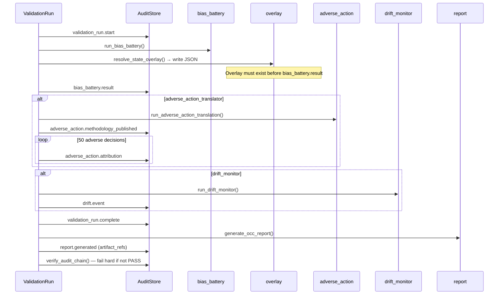
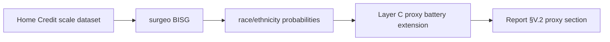

# AI Model Risk & Governance Workbench — Technical Deep Dive

**Audience:** Professional interview / technical review (MRM & compliance primary; ML/statistics secondary)  
**Prerequisite:** [01-teaching-guide.md](./01-teaching-guide.md)  
**Live reference run:** `german-credit-demo-ca-overlay` (2026-07-23)

---

## Table of contents

1. [Problem and regulatory context](#problem-and-regulatory-context)
2. [Scope and differentiation](#scope-and-differentiation)
3. [Architecture overview](#architecture-overview)
4. [Pipeline orchestration](#pipeline-orchestration)
5. [Bias battery statistics](#bias-battery-statistics)
6. [Adverse action pipeline](#adverse-action-pipeline)
7. [Drift monitoring](#drift-monitoring)
8. [CA overlay P3](#ca-overlay-p3)
9. [Audit hash chain](#audit-hash-chain)
10. [Artifact schema reference](#artifact-schema-reference)
11. [Design decisions and tradeoffs](#design-decisions-tradeoffs)
12. [P4 BISG architecture](#p4-bisg-architecture)
13. [Interview concepts](#interview-concepts)

---

## Problem and regulatory context

### Regulatory stack (what examiners expect)

The workbench maps to three overlapping obligation layers:

| Layer | Instrument | Workbench response |
| ----- | ---------- | ------------------ |
| **Model risk** | OCC Bulletin 2026-13 (seven-section independent validation) | Jinja2 `report.md.j2` → §I–VII Markdown report |
| **Fair lending** | ECOA / Reg B; post–July 2026 **proxy discrimination** emphasis (R-02) | Three-layer `bias_battery` under `federal_ecoa: proxy_discrimination` |
| **Adverse action** | Reg B §1002.9 specific reasons | `adverse_action` module: TreeSHAP → factor descriptions + versioned methodology |
| **State overlay** | California CCPA/CPRA ADMT (CPPA regs tit. 11) | P3 `state_overlay: CA` → `admt_risk_assessment_summary.json` |
| **Evidence controls** | FINOS AIR-DET-021 (audit trail) | SQLite hash chain with `finos_control` IDs (`mi-5`, `mi-21`, `mi-4`) |

### Critical messaging boundary

The federal **disparate impact** theory of liability was narrowed in the July 2026 Reg B framing (R-02). The workbench therefore:

- Uses `proxy_discrimination` as the federal statistical frame.
- Labels Layer A output as `outcomes_analysis_risk_assessment_evidence` — never ECOA compliance.
- Embeds §I disclaimer in every generated report.

### CFPB circular hygiene (R-12, R-14)

- **Do not cite** a distinct CFPB Circular numbered “2026-03” — no primary source verified.
- Circulars 2022-03 and 2023-03 were **withdrawn May 12, 2025**; methodology artifact may reference them as **historical interpretive context** only.
- CI `scripts/check_circular_banlist.sh` enforces shipping copy discipline.

---

## Scope and differentiation

### Market positioning (four layers — R-01)

| Layer | Examples | Workbench position |
| ----- | -------- | ------------------ |
| A. MRM lifecycle | ValidMind, SAS, ModelOp | Closest analog — but closed, enterprise-priced |
| B. AI GRC | Credo AI, IBM watsonx | Policy breadth > statistical depth |
| C. Observability | Fiddler, Arthur | Production monitoring; weak pre-deployment validation reports |
| D. OSS components | Fairlearn, SHAP, FINOS | **Compose on top** — differentiate on structure + evidence |

### Primary differentiators (ship first)

1. **Post–July 2026 proxy-discrimination battery** with jurisdiction overlay toggles.
2. **OCC 2026-13 literal seven-section report** with hash-bound appendices.
3. **Documented SHAP → Reg B §1002.9 translation methodology** (versioned JSON + Markdown).

### Explicit out-of-scope (v1)

Enterprise GRC, SaaS multi-tenancy, gen-AI MRM completeness, FCRA key-factors engine, algorithmic debiasing, real-time Kafka streaming, 50-state overlays, ONNX/PMML ingest, Postgres audit backend.

---

## Architecture overview

### Package layout

```
src/workbench/
├── sdk.py                 # ValidationRun orchestrator
├── config.py              # YAML → ValidationRunConfig dataclasses
├── ingest/                # Model/dataset load + gates
├── materiality/           # T1/T2/T3 assignment
├── bias_battery/          # Fairlearn MetricFrame + Layer C classifier
├── adverse_action/        # TreeSHAP + feature_dictionary + fidelity
├── drift/                 # PSI (Lewis bins) + KS + escalation matrix
├── overlay/               # CA ADMT / CO disclosure profiles
├── report/                # Jinja2 OCC template
├── audit/                 # SQLite append-only hash chain
├── api/                   # FastAPI thin wrapper
└── cli/main.py            # Typer entry points
```

### Tech stack

| Concern | Choice | Rationale |
| ------- | ------ | --------- |
| Runtime | Python ≥3.11, uv lockfile | Reproducible deps; CI matrix 3.11/3.12 |
| ML | XGBoost pipeline (joblib), sklearn preprocessing | Frozen demo model; `feature_names_in_` contract |
| Fairness | fairlearn MetricFrame; aequitas pinned 1.1.0 | Standard metrics; version recorded in bias summary |
| Explainability | shap.TreeExplainer | R-04: TreeSHAP only for tree models |
| Drift | scipy KS + custom PSI | Lewis (1994) decile bins on reference population |
| Report | Jinja2 + jsonschema validation in tests | Human + machine outputs |
| Audit | SQLite + SHA-256 chain | FINOS Tier 1–2 local evidence |
| API | FastAPI (optional `[api]` extra) | POST /validate smoke-tested in phase2 |

### Configuration contract

All runs driven by `validation_run:` YAML block. Key fields for P3 CA:

```yaml
regulatory_frame:
  federal_ecoa: proxy_discrimination
  state_overlay: CA
materiality:
  exposure: 0.15
  purpose: credit_decisioning
modules:
  bias_battery: true
  adverse_action_translator: true
  drift_monitor: true
```

Paths resolved relative to CWD; `protected_class_registry.yaml` loaded at ingest.

---

## Pipeline orchestration

`ValidationRun.run()` in `src/workbench/sdk.py` enforces strict ordering:



### Hard failure modes

| Gate | Failure |
| ---- | ------- |
| Intake gate | `ValueError` — non-statistical methodology |
| Protected-class gate | `ValueError` — prohibited feature in model |
| No adverse decisions | `ValueError` — cannot run adverse action |
| Audit chain break | `RuntimeError` — run aborts after report generation |

### Materiality engine

```python
# T3 if exposure >= 0.10 OR purpose == credit_decisioning
# T2 if exposure >= 0.01
# T1 otherwise
```

Demo configs always land **T3** (exposure 0.15 + credit_decisioning).

---

## Bias battery statistics

Implementation: `src/workbench/bias_battery/__init__.py`

### Layer A — Outcomes (`_layer_a_outcomes`)

| Metric | Definition | Live value (sex, ref=male) |
| ------ | ---------- | -------------------------- |
| **AIR** | min(non-ref selection rate) / ref selection rate | **0.991** |
| **selection_rate_gap** | female rate − male rate | **−0.007** |
| **smd_score** | Standardized mean difference of model scores | **−0.012** |

- Uses `fairlearn.metrics.MetricFrame` with `selection_rate` on binary decisions.
- SMD computed on continuous model scores (predict_proba positive class).

**Interpretation for interviews:** Near-parity on outcomes in this 300-row slice. Negative gap means female selection rate slightly lower — small magnitude. This supports risk review narrative; it does **not** trigger or clear legal thresholds.

### Layer B — Error parity (`_layer_b_error_parity`)

| Metric | Definition | Live value |
| ------ | ---------- | ---------- |
| **fpr_parity_ratio** | female FPR / male FPR | **0.987** |
| **fnr_parity_ratio** | female FNR / male FNR | **0.860** |

- FPR/FNR via MetricFrame on labels vs decisions.
- Parity ratio = 1.0 is exact parity; &lt;1 means protected group has lower rate vs reference.

**Interpretation:** FNR parity 0.86 indicates females experience fewer false negatives (model says “bad” when label is “good”) relative to males — asymmetric error burden worth flagging in §V.2 discussion, not automatically adverse.

### Layer C — Proxy risk (`_layer_c_proxy_risk`)

Two signals:

1. **Top proxy correlations** — absolute Pearson correlation between each numeric/encoded feature and protected attribute.
2. **Auxiliary classifier AUC** — logistic regression predicting protected attribute from model features (80/20 stratified split, `random_state=42`).

Live results:

| Feature | \|r\| with sex |
| ------- | ------------- |
| num_dependents | 0.148 |
| residence_since | 0.130 |
| age | 0.129 |
| credit_history | 0.129 |
| own_telephone | 0.111 |

Auxiliary classifier AUC: **0.660**

**Interpretation:** Moderate proxy signal — features partially encode sex. Under proxy-discrimination framing, this motivates Layer C review even when Layer A looks clean. Cross-reference with adverse-action reasons (see §V.2 proxy overlap: `credit_history`).

### Regulatory payload labels

```json
"layer_a_label": "outcomes_analysis_risk_assessment_evidence"
```

Never emitted as disparate-impact compliance.

---

## Adverse action pipeline

Implementation: `src/workbench/adverse_action/__init__.py` + `feature_dictionary.py`

### Four stages (R-04 §4)

| Stage | Action |
| ----- | ------ |
| 1 | TreeSHAP attribution per denied applicant (margin/log-odds output) |
| 2 | Map encoded features → Reg B factor descriptions via `describe_factor()` |
| 3 | Fidelity validation batch (N=50) |
| 4 | Consumer reason strings + audit `adverse_action.attribution` events |

### One-hot aggregation rule

Categorical SHAP contributions are **summed to parent raw feature** before ranking principal reasons. This prevents “purpose_car” from ranking separately from “purpose” — examiners see economically meaningful factors.

### Principal reason selection

- Top-K = 4 features with most negative aggregated SHAP (push toward denial).
- Ranked by SHAP contribution ascending (most negative first).

### Fidelity tests (Appendix D)

| Test | Threshold | Live result |
| ---- | --------- | ----------- |
| Rank stability | 100% | **PASS** (1.0) |
| Perturbation fidelity | ≥90% | **PASS** (1.0) |
| Automated specificity proxy | ≥95% | **PASS** (1.0) |
| Surrogate agreement | N/A | XGBoost — no linear surrogate |
| LIME stability | N/A | SHAP-only decision |

**Perturbation method:** Zero one-hot block or set numeric feature to validation population mean; verify approval probability does not decrease.

### Methodology artifact

- `translation_methodology_v1.json` — machine-readable mapping rules, limitations, regulatory anchors.
- Hash-bound in `adverse_action.methodology_published` audit event (`finos_control: mi-21`).
- 250 cumulative `adverse_action.attribution` events in DB (50 per run × prior runs).

### Top global features (fidelity batch)

`checking_status`, `duration`, `purpose`, `credit_amount`, `credit_history`

---

## Drift monitoring

Implementation: `src/workbench/drift/__init__.py`

### Methodology

| Component | Method |
| --------- | ------ |
| **PSI** | Lewis (1994) decile bins fit on **reference** (development) population |
| **Thresholds** | Green &lt;0.10, Amber 0.10–0.25, Red ≥0.25 (industry heuristics — not sample-size adjusted, R-05 §3.1) |
| **KS** | `scipy.stats.ks_2samp` on reference vs monitor |
| **Segment drift** | Score PSI computed separately by protected attribute groups |

### Live P3 results

| Signal | PSI | Alert |
| ------ | --- | ----- |
| Model score | 0.221 | RED |
| duration | 0.380 | RED |
| credit_amount | 0.186 | RED |
| installment_commitment | 0.007 | GREEN |
| Segment: female | 0.232 | AMBER |
| Segment: male | 0.251 | RED |

**Overall:** RED at **T3** → recommended action: *"Full re-validation trigger; model use restriction pending review; MRM committee convened within 15 days."*

### Injected shift (demo honesty)

`scripts/inject_monitor_shift.py`:

- `duration` × 1.35 + N(0,2) noise
- `credit_amount` +2000 EUR on 40% of rows
- `installment_commitment` resampled with +15% mean shift

German Credit lacks application timestamps — temporal production drift cannot be demonstrated; covariate injection is the pedagogical substitute (R-10 §4.5).

### Escalation matrix (R-05 §4.2)

Materiality tier × alert level → `recommended_action`, `validator_notification_days`, `cadence`. T3 Red is the maximum escalation path in the demo.

---

## CA overlay P3

Implementation: `src/workbench/overlay/__init__.py`

### Profile resolution

`state_overlay: CA` activates:

| Output | Content |
| ------ | ------- |
| `admt_risk_assessment_summary.json` | ADMT risk-assessment template with Layer A/B/C metrics embedded |
| Report §II | Dual regulatory frames table + significant decision category |
| `bias_battery_summary.json` | `jurisdiction_frame.state_authority` populated |

### Ordering invariant

Overlay JSON is written to disk **before** `bias_battery.result` audit event so SHA-256 refs can be included in the append-only log. Reordering would break hash-binding integrity.

### Non-claims (embedded in artifact and report)

> Does not constitute CPPA certification or a California Attorney General compliance determination.

### CO alternative (`german_credit_co_overlay.yaml`)

Emits `co_disclosure_checklist.json` only — simpler disclosure stub; documented as secondary demo path.

### What does NOT change

Underlying Layer A/B/C computations, model scores, SHAP attributions, and drift PSI values are identical between federal-only and CA overlay runs. Only framing, report narrative, and supplemental JSON differ.

---

## Audit hash chain

Implementation: `src/workbench/audit/__init__.py`

### Chain construction

For each event:

```
payload_hash = SHA256(canonical_json(payload))
metadata     = event_id | event_type | timestamp | model_id | version | tier | actor | finos_control | finos_tier
chain_hash   = SHA256(prev_hash + payload_hash + metadata)
```

Genesis `prev_hash` = 64 zeros.

### Append-only enforcement

SQLite triggers reject UPDATE/DELETE on `audit_log` table.

### Tier-2 event types

```python
TIER2_EVENT_TYPES = {
    "bias_battery.result",
    "adverse_action.attribution",
    "adverse_action.methodology_published",
}
```

Tier-2 events may include `artifact_refs: [{name, sha256}, ...]`.

### Full P3 event sequence (single run)

1. `validation_run.start` (mi-5)
2. `bias_battery.result` (mi-5)
3. `adverse_action.methodology_published` (mi-21) + artifact refs
4. `adverse_action.attribution` × 50 (mi-21)
5. `drift.event` (mi-4) + drift_report ref
6. `validation_run.complete` (mi-5)
7. `report.generated` (mi-21) + all appendix refs

### Verification

`workbench audit verify-chain` recomputes chain; any tampered payload or broken link surfaces in `breaks[]`. SDK raises `RuntimeError` if verification fails post-report.

### Property tests

`tests/phase0/test_phase0_audit_properties.py` uses Hypothesis for chain stability, tamper detection, `seq_id` monotonicity.

---

## Artifact schema reference

JSON Schemas in `schemas/` — validated in phase-gated integration tests:

| Schema | Artifact |
| ------ | -------- |
| `bias_battery_summary.schema.json` | Appendix B |
| `translation_methodology_v1.schema.json` | Appendix A |
| `fidelity_validation.schema.json` | Appendix D |
| `drift_report.schema.json` | Appendix C |
| `admt_risk_assessment.schema.json` | P3 CA overlay |
| `co_disclosure_checklist.schema.json` | P3 CO overlay |

### Fixture integrity

`manifests/german_credit_fixture_manifest.yaml` pins SHA-256 for data, model, feature mapping. `scripts/check_fixture_hashes.sh` runs in CI — any byte change fails the build.

### report.json structure

Machine-readable index: run_id, model metadata, disclaimer, appendix paths, audit summary — enables `GET /report/{run_id}` API surface.

---

## Design decisions and tradeoffs

### Why compose OSS instead of custom metrics?

**Pros:** Examiner familiarity, maintenance burden low, test focus on orchestration and evidence chain.  
**Cons:** Less defensible “novel metric” IP; differentiation is workflow and regulatory mapping.

### Why frozen model via Git LFS?

**Pros:** Bit-exact reproducibility across CI, demos, and portfolio reviewers.  
**Cons:** Cannot demonstrate training-data drift or retraining workflow in v1.

### Why SQLite over Postgres?

**Pros:** Zero infra; portable demo; append-only triggers sufficient for Tier 1–2 FINOS citation.  
**Cons:** No horizontal scaling, no enterprise SIEM integration.

### Why YAML configs over UI?

**Pros:** Version control, diffable validation runs, CI-friendly.  
**Cons:** Non-technical users need CLI wrapper or future UI.

### Why phase-gated CI?

PR labels (`phase:p0`–`phase:p3`) set pytest floor minimum. P4 notebook excluded — prevents scope creep blocking merges.

### Why CLI canonical over notebooks?

Notebooks restored as **companion surface** (dropped AC notebook per R-10) but CLI is source of truth for reproducibility and golden tests.

---

## P4 BISG architecture

### Problem statement

US fair lending analysis often requires race/ethnicity proxy estimation when direct collection is absent. German Credit lacks surname and ZCTA fields.

### Documented architecture (`notebooks/02_home_credit_bias_proxy.ipynb`)



- **Library:** `surgeo` 1.1.2 (2010 Census tables — 2020 DHC gap documented in deep-research §10.2).
- **Illustrative data:** `data/illustrative/home_credit_bisg_proxy_sample.csv` (synthetic US panel, not vendored Kaggle dump).
- **Status:** No `workbench` module; no CI gate; architecture evidence only.

### Integration path (if built)

1. Extend `protected_class_registry.yaml` for BISG-derived attributes.
2. Add ingest path for surname + ZIP/ZCTA columns.
3. Run `surgeo` at Layer C only (never as model feature — same gate as `sex`).
4. Emit BISG proxy summary appendix with same hash-chain binding pattern.

---

## Interview concepts

### Elevator pitch (30 seconds)

> “I built an open validation workbench that takes a deployed credit model and labeled data, runs a three-layer proxy-discrimination battery, translates TreeSHAP attributions into Reg B adverse-action methodology with fidelity tests, monitors population drift with tier-gated escalation, and outputs an OCC seven-section report with a hash-chained audit log. It’s review support for validators — not a lending system or compliance determination.”

### System design talking points

1. **Separation of concerns:** ingest gates → analytics modules → report generator → audit store. Each module returns structured payloads; SDK owns orchestration and event ordering.
2. **Evidence chain:** artifact SHA-256 refs in Tier-2 audit events; report generation is not complete until chain verifies.
3. **Regulatory configurability:** `regulatory_frame` toggles federal frame and state overlay without code changes.
4. **Fail-closed audit:** broken chain aborts run — prefer false stop over silent tampering.
5. **Test strategy:** phase-gated integration + golden report strings + Hypothesis property tests on audit chain.

### MRM / compliance questions

| Question | Strong answer |
| -------- | ------------- |
| “Is this compliant?” | “It produces structured validation **evidence** per OCC 2026-13 format. Compliance is an organizational/legal determination outside the tool.” |
| “Why proxy discrimination frame?” | “Post–July 2026 federal emphasis per R-02; we don’t assert disparate-impact compliance.” |
| “How do you handle adverse action?” | “Versioned methodology artifact hash-bound in audit; fidelity batch validates rank stability and perturbation; feature dictionary maps to Reg B specific reasons.” |
| “What about state law?” | “P3 demonstrates jurisdictional framing toggle — CA ADMT artifact on same metrics. Explicit non-claims in report.” |

### ML / statistics questions

| Question | Strong answer |
| -------- | ------------- |
| “Why AIR near 1.0 but still review?” | “Layer A parity doesn’t rule out proxy discrimination — Layer C AUC 0.66 and feature correlations motivate proxy review.” |
| “Why TreeSHAP not LIME?” | “Tree model; R-04 decision for stability; fidelity tests designed around SHAP recomputation.” |
| “PSI 0.22 — is that bad?” | “At T3, score PSI 0.22 triggers RED escalation per documented matrix. In this demo, shift is injected to exercise the workflow.” |
| “How do you prevent protected attribute in model?” | “Ingest gate compares `feature_names_in_` against `protected_class_registry.yaml`; collision raises ValueError.” |

### Competitive differentiation (vs ValidMind / Fiddler)

- **ValidMind:** Enterprise MRM lifecycle — we’re open validation engine with OCC literal structure and adverse-action methodology artifact.
- **Fiddler:** Production observability + SHAP — we’re pre-deployment validation report + hash chain + Reg B translation pipeline.
- **Fairlearn alone:** Metrics library — we add tiering, report, audit, regulatory frames, escalation.

### Known limitations to volunteer (builds trust)

1. German Credit — non-US, 1990s, sex-only protected attribute.
2. Injected drift — not production temporal monitoring.
3. P3 CA overlay — framing demo on non-CA population data.
4. P4 BISG — notebook architecture only.
5. No human-in-the-loop sample audit in demo (`human_review_status: not_performed_demo_limitation`).

---

*Cross-reference: [01-teaching-guide.md](./01-teaching-guide.md) · [README.md](../../README.md) · [deep-research-v1.md](../../deep-research-v1.md)*
